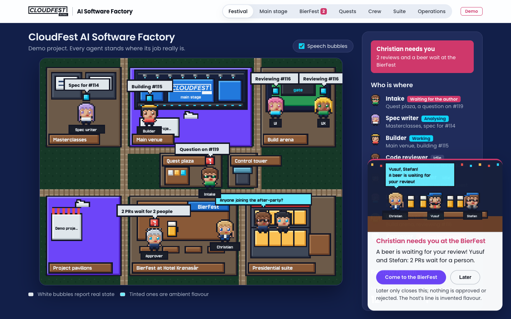
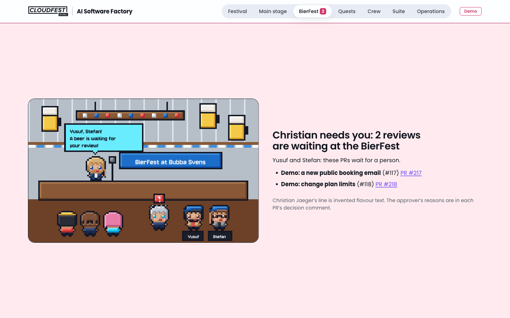
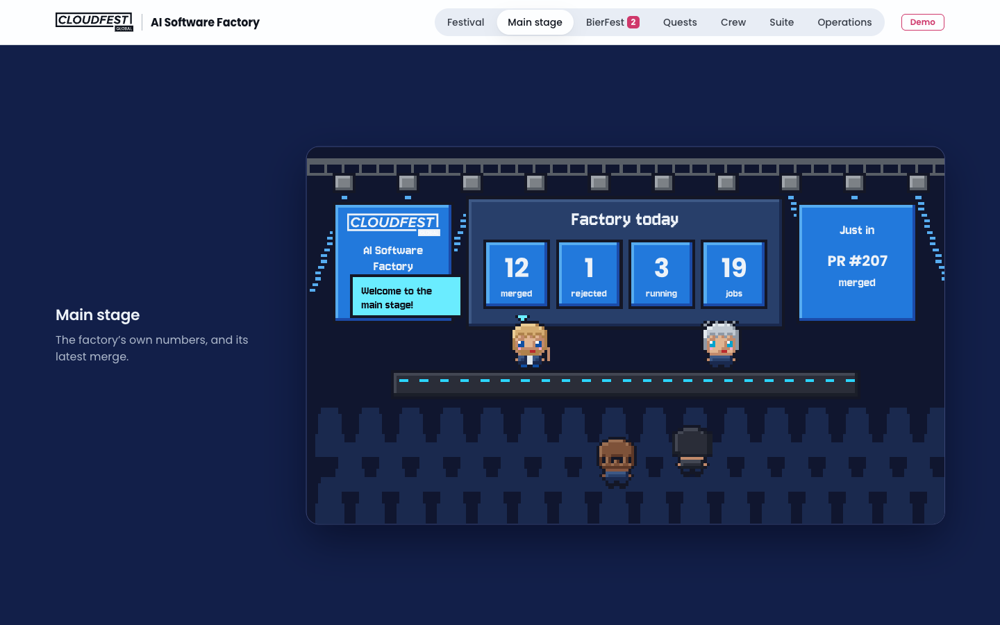
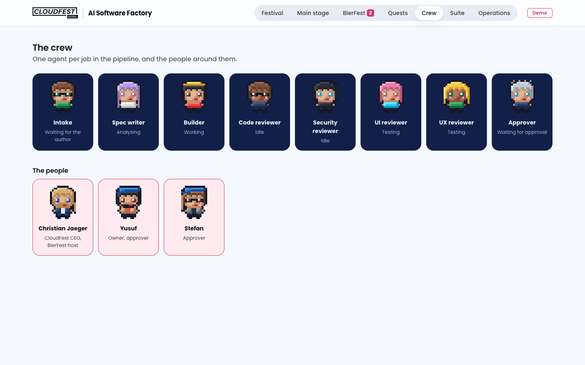
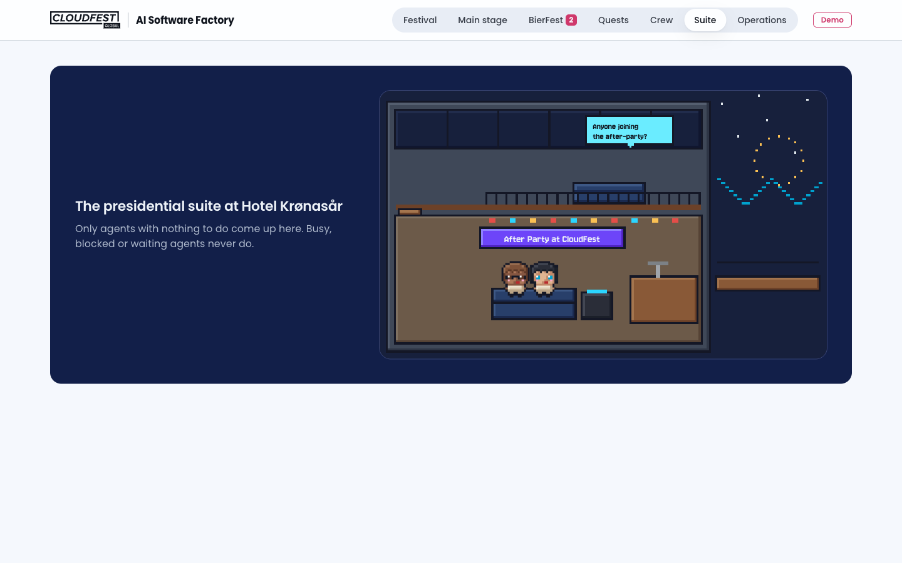

# CloudFest After Party

**A CloudFest-style AI software factory for Claude Code.** Install it once as a
plugin, point it at any GitHub repository, and a crew of AI agents turns issues
labelled `factory` into reviewed pull requests:

```
intake → spec → build → gate → review → approve → merge
```

The look and feel is a technology festival in the spirit of CloudFest: agents
work at the main venue, learn in the masterclasses, prove their builds in the
build arena, wait for a human at the Beer Fest, and relax at the after party
when there's nothing to do. The festival is only the presentation. Underneath,
every step is checked by code, not trust: a job moves on only when the files
that justify the move exist, the branch passes the project's checks taken from
its base branch, and no protected file was touched.



> CloudFest After Party is an independent project, built with permission from
> CloudFest; it is not an official CloudFest product. The CloudFest logos and
> the cartoon cameos of Christian Jaeger (CloudFest CEO), Yusuf and Stefan are
> used with permission and consent; see `plugin/themes/cloudfest/ASSETS.md`.
> Their in-world lines are invented flavour text.

## The dashboard

```
party-dashboard            the festival for the project you're in, on http://127.0.0.1:8765/
party-dashboard --demo     the same, with clearly labelled sample data
```

Every agent stands where its job really is, and moves only when a job moves:
intake and spec in the Masterclasses, the builder at its project's booth,
checks and reviews in the Build arena, idle agents up in the presidential
suite. White speech bubbles report real state; tinted ones are flavour, and a
switch turns them off. Hover over anyone to see who they are.

When the approver escalates a PR to a person, the host calls them to the
BierFest: "A beer is waiting for your review!" Closing that call approves
nothing.

| | |
|---|---|
|  |  |
|  |  |

Name the people who approve escalated PRs in `.factory/config.json`, for
example `"approvers": ["yusuf", "stefan"]`; the theme's people get their
cameo, anyone else a plain character with their name.

## Install

In Claude Code:

```
/plugin marketplace add Linztric801/ai-software-factory
/plugin install cloudfest@cloudfest-after-party
```

Then, in the repository you want built:

```
/cloudfest:after-party run          build every open issue labelled `factory`
/cloudfest:after-party run 12       build issue #12
/cloudfest:after-party <anything>   ask about jobs, give feedback, file a feature
```

Nothing of the factory lives in your project. Job state and the agents'
worktrees are kept in `~/.cloudfest-after-party/projects/<owner>-<repo>/`.

## Set up a project

A project needs one thing: a checks script the gate runs on every round.

```
.factory/
  checks.sh      required: exit 0 only when the branch is fit to review
  config.json    optional: overrides of the plugin defaults (concurrency, routing,
                 protected paths, merge method, …)
  profile.md     optional: what the project is, and its rules for each agent:
                 ## Project, ## Intake, ## Dev server, ## Security review,
                 ## UI review, ## UX review, ## Approver
```

Coming from a factory that lived in the repo (`factory/jobs/`)? `party-import factory/jobs`
brings its jobs over, and numbering continues after them.

`party-job where` shows which project, state folder, settings and checks the
factory found. Settings are layered: the plugin's `config.default.json`, then
`.factory/config.json`, then `~/.cloudfest-after-party/projects/<slug>/config.json`
for machine-local overrides. Protected paths can be added, never removed.

## Approval, XP and the sandbox

**A person approves before anything merges.** With `merge_policy` at
`human_required` (the default), an approved PR waits at the BierFest until a
person runs `party-job approve <job>` in their own terminal and types the PR
number, or merges it on GitHub. Claude can't approve: the command needs a real
terminal, a guard hook stops Claude from running it or merging PRs directly,
and the merge requires an approval record that sandboxed agents can't write.
Set `"merge_policy": "auto_after_approval"` to let the approver agent merge on
its own. Name who may approve with `"approvers"`.

**XP for verified work.** Agents earn XP only when a job they worked on is
merged: intake 10, spec 15, builder 40 for a first-round merge (25 later),
each reviewer 10, approver 10, configurable under `"xp"`. `party-job xp`
explains every point; the dashboard's Crew view shows levels from New recruit
to Master. Levels are cosmetic and grant no rights.

**The sandbox.** `party-sandbox --write` turns on Claude Code's sandbox for the
project: the agents' commands may write only to the project, the factory's
state folder and build caches; can't read SSH keys or cloud credentials; and
reach only GitHub, the npm registry, Anthropic and the domains you list under
`"sandbox": {"allowed_domains": [...]}`. GitHub access stays, because the
builder pushes and opens PRs. `party-sandbox --off` removes it.

## Safety rules the code enforces

- Only issues with the `factory` label run, and issue text reaches agents only
  as quoted data.
- The gate runs the checks from the main checkout, never from the branch, and
  fails a branch that changes protected files or adds files under `.github/`,
  `.claude/` or `.factory/`.
- Approval and merge act only on the exact commit that passed the gate and the
  reviews; the merge pins that commit.
- A job gets at most `max_rounds` build rounds before a human decides.
- Commits carry no AI attribution trailers.

## Develop

```sh
cd plugin/tests && python3 -m unittest -v
```

The tests run the real scripts against a throwaway git repository and a fake
`gh`. Needs Python 3.11+, git and the GitHub CLI.

## License

MIT. See `LICENSE`.
